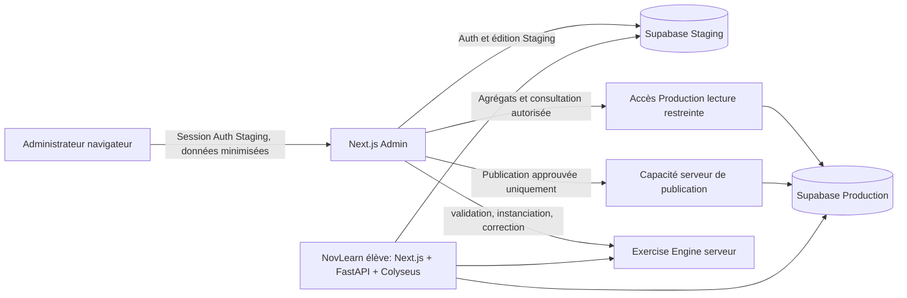

# Architecture cible et audit du Lot 0 bis

Ce rapport conserve les constats du Lot 0 bis. Depuis D02, le code Auth et le
layout sont préparés localement, avec accès Staging désactivé. L'état courant
et ses preuves sont dans [Auth](auth.md) et [progression](progress.md) ; les
paragraphes décrivant le socle vide correspondent au relevé initial.

État au 13 octobre 2026. Ce document distingue les faits vérifiés dans les dépôts et métadonnées accessibles, les déclarations du CDC et les recommandations à valider. Aucun changement fonctionnel n'est implémenté ici.

## Architecture recommandée

`novlearn-admin` reste une application Next.js full-stack, distincte du frontend élève, du backend FastAPI et de Colyseus de `Novlearn`. Ses composants serveur et routes contrôlées portent les accès privilégiés. Le navigateur n'obtient que la session Auth Staging et des données explicitement projetées pour l'interface.

Supabase Staging est le plan de travail éditorial et la source Auth de l'Admin. Production est une frontière distincte : requêtes statistiques minimisées en lecture, consultation des utilisateurs selon un besoin autorisé, et une capacité de publication dédiée et contrôlée. Une clé secrète Supabase n'étant pas limitée par son nom, ne pas utiliser une clé `service_role` partagée comme mécanisme de permissions. Les accès de Production ne sont pas encore implémentés et aucun secret/client Production ne doit être ajouté avant conception des permissions effectives.

L'Exercise Engine est appelé exclusivement côté serveur pour valider les définitions, instancier par seed, produire la projection publique et corriger depuis l'instance privée. MathLive est une interface de saisie ; il ne porte aucun calcul métier. NovLearn Admin ne copie aucune logique mathématique historique.

Le modèle est désormais validé : identité stable dans `public.exercises`, révisions dans `public.exercise_versions`. La publication transfère uniquement leur contenu métier approuvé, en préservant les versions publiées immuables et les instances des nouvelles tentatives. Cette sélection ne réplique ni les lignes complètes ni les autres tables. Les migrations de structure pour la compatibilité restent un processus distinct. Les détails SQL sont décrits dans [le modèle des exercices](exercise-data-model.md).

Le schéma représente une cible. Dans le dépôt Admin actuellement inspecté, seuls le socle Next.js App Router, la page statique, les styles, TypeScript strict et `output: standalone` sont présents. Aucun client Supabase, API métier, route protégée ou accès Engine n'est implémenté. La copie de travail préexistante de `.env.example` propose `APP_BASE_URL` et des noms fictifs pour l'URL et la clé publique Staging ; aucun code ne les lit actuellement. Ce diff local est conservé hors du commit documentaire ; les anciens placeholders versionnés ne confèrent pas de permissions réelles.

## Frontières et responsabilités

| Composant          | Responsabilité                                                                                                    | Interdit / limite                                                                 |
| ------------------ | ----------------------------------------------------------------------------------------------------------------- | --------------------------------------------------------------------------------- |
| Navigateur Admin   | UI, session Auth Staging, saisie et aperçu d'informations permises                                                | Aucun secret, client Production privilégié, correction faisant autorité           |
| Serveur Admin      | Authentifier, vérifier rôle et intention à chaque action, valider l'entrée, appeler Engine, minimiser les données | Ne jamais faire confiance au seul masquage UI ou à un rôle transmis par le client |
| Staging            | Comptes Admin, brouillons et contenu de travail                                                                   | Pas de dépendance aux données personnelles réelles de Production                  |
| Production lecture | Requêtes nécessaires aux indicateurs et consultations explicitement autorisées                                    | Pas de clé générale donnant une écriture accidentelle                             |
| Publication        | Opération séparée, journalisée, exercice approuvé uniquement                                                      | Pas de réplication ou synchronisation générale                                    |
| NovLearn           | Exécution élève et API existantes, dont FastAPI et Colyseus                                                       | Pas de modification dans le cadre de ce lot                                       |
| Exercise Engine    | Contrats canoniques, validation, génération, projection, correction et diagnostics                                | Ne fournit ni auth, ni stockage, ni rendu d'interface                             |

## Propriété des migrations

Les migrations existantes se trouvent dans `Novlearn/supabase/migrations/`. Recommandation : conserver un seul historique canonique des migrations partagé dans le dépôt NovLearn, qui possède déjà le code serveur et les migrations actuelles. Toute évolution de schéma requise par l'Admin serait examinée et ajoutée à cette source canonique, puis appliquée à Staging et Production par un mécanisme approuvé. Le dépôt Admin ne doit pas créer une deuxième suite de migrations concurrente. Ce choix de gouvernance doit être validé avec le propriétaire du dépôt NovLearn avant toute migration.

## Sources et limites de l'audit

- Les `AGENTS.md`, `CDC_reference.md`, `README.md`, documents `docs/`, `package.json`, `tsconfig.json` et `next.config.ts` du dépôt ont été consultés. Après le Lot 0 bis, l'utilisateur a expressément autorisé le 13 octobre 2026 une mise à jour ciblée du CDC sur le modèle, le versionnement, la publication et les arbitrages associés. Cette exception est tracée dans [les décisions](decisions.md).
- Les répertoires frères `Novlearn` et `Novlearn-Engine` étaient lisibles ; leurs fichiers ont été consultés en lecture seule. La préparation du Lot 1A a également relevé le commit et le statut Git de NovLearn avec une exception de confiance limitée à la commande et sans verrou optionnel ; aucun paramètre global Git ou fichier voisin n'a été modifié.
- La liste des tables et migrations, les colonnes/FK pertinentes, les politiques RLS et définitions des trois fonctions SQL ont été lues par outils Supabase en lecture seule pour les projets nommés `novlearn-prod` et `novlearn-staging`.
- Aucun jeu de lignes métier, identité utilisateur, ni secret n'a été demandé. Aucun SQL d'écriture, migration, changement de permission, déploiement ou exécution de code externe n'a eu lieu.
- Les projets exposent chacun 22 tables `public`. Les colonnes et relations des exercices, tentatives, duels et profils sont identiques dans les métadonnées lues. Les moteurs Postgres déclarés sont 17, avec des versions mineures différentes au moment de l'audit.
- Les environnements déclarent la même liste de versions/noms de migrations. Cette égalité d'historique déclaré ne prouve pas que les fichiers Git reproduisent les changements effectifs, ni qu'aucune modification manuelle n'a eu lieu.
- Dans l'état inspecté, les définitions présentes de `get_random_exercise`, `get_monthly_leaderboard` et `get_weekly_leaderboard` étaient équivalentes entre les deux projets. Elles sont toutes `SECURITY DEFINER`; les deux définitions de leaderboard exposent des noms et données de scores. Le signalement historique de divergences du CDC n'est donc pas confirmé par ce relevé actuel. Vérifier également ACL, dépendances, propriétaires et historiques SQL avant changement.
- La certification la plus récente documentée de l'Engine (13 octobre 2026) signale un échec de transport isolé Windows (`worker unavailable`) et le juge non prêt au pilote. Le contrat est suffisamment documenté pour spécifier une future intégration, mais l'emploi en production reste bloqué à une qualification et compatibilité de runtime réussies.

## Préparation du Lot 1A

Le choix des deux tables et leur périmètre de publication sont clos. Le [dossier Lot 1A](lot-1a-preparation.md) prépare la réconciliation des migrations et la sécurisation SQL avec des requêtes de métadonnées exclusivement en lecture. Il n'applique aucun correctif et ne crée pas `exercise_versions`. La propriété des migrations, le mapping des identifiants, les champs/versionnement précis et les permissions Production restent à finaliser. La roadmap impose la sécurisation avant le lot fonctionnel d'authentification.
