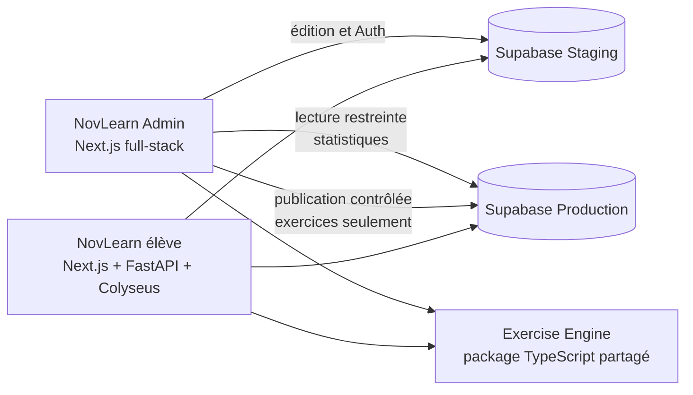

# Architecture

## Écosystème cible

NovLearn Admin est un repository Next.js full-stack indépendant. Il fournit à terme l'interface d'administration et ses opérations serveur. Il n'ajoute pas de backend FastAPI. NovLearn élève conserve son frontend Next.js, son backend FastAPI et son serveur Colyseus pour les duels. NovLearn Admin et NovLearn consommeront le package TypeScript partagé `novlearn-exercise-engine` pour les contrats, la génération et la correction des exercices ; l'Admin ne doit pas réimplémenter ces règles.

Deux projets Supabase distincts sont prévus : Staging pour l'authentification administrative et le travail éditorial ; Production pour les données réelles, consultées de manière limitée, et la publication explicitement autorisée des exercices. La V1 ne synchronise pas les autres tables métier.

Le schéma illustre la cible, pas des connexions déjà créées. Les détails d'accès, de publication et les questions non résolues figurent dans [environments.md](environments.md), [exercise-workflow.md](exercise-workflow.md) et [decisions.md](decisions.md).

## Frontières serveur / navigateur

Les composants serveur, Server Actions et Route Handlers porteront les opérations qui exigent autorisation, secrets ou accès aux données. Le navigateur ne reçoit que les données nécessaires à l'interface. Les contrôles de rôle sont effectués côté serveur à chaque opération protégée. Une clé privilégiée n'est jamais préfixée `NEXT_PUBLIC_`.

La lecture Production pour les statistiques et la capacité d'écriture de publication sont des responsabilités serveur distinctes, avec des permissions minimales. L'application ne doit pas présumer qu'une clé `service_role` générale est nécessaire.

## Socle actuellement implémenté

Le dépôt contient une application Next.js App Router avec une page d'accueil statique, un layout, du CSS global et une configuration Tailwind. Le build vise la sortie autonome. Les configurations TypeScript, ESLint, Prettier et shadcn/ui sont préparées. Aucun accès Supabase, moteur, API métier, route protégée ou interface d'administration fonctionnelle n'est présent.

## Sources et limites

Le CDC décrit deux projets Supabase existants et un audit initial. Les repositories voisins NovLearn, Exercise Engine et Creator étaient accessibles en lecture seule et ont été consultés pour la stack, les responsabilités et les conventions documentées. Aucun accès aux bases ni inspection de schéma vivant n'a été effectué dans ce Lot 0. Les détails qui en dépendent restent à confirmer avant les lots concernés.
