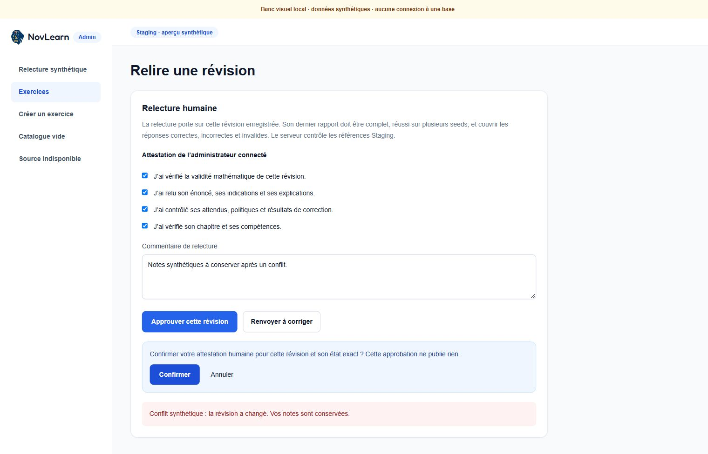

# Relecture humaine — implémentation locale

La fiche de révision permet une demande de relecture, une approbation avec quatre
attestations explicites et un retour à corriger avec motif. La confirmation est
distincte des tests ; une approbation n’active ni ne publie l’exercice. Les dix
derniers événements sont consultables, avec acteur, date, commentaire,
attestation, empreinte, compteur d’état et reçu Engine. Une erreur conserve les
notes et les cases du formulaire.

## Contrôle serveur et SQL

`POST /api/admin/review` utilise uniquement Auth Staging, l’origine exacte et le
rôle Admin relu côté serveur. Son entrée stricte refuse les acteurs, verdicts,
définitions ou environnements fournis par le navigateur. La route est fermée
par défaut : `ADMIN_EDITORIAL_REVIEW_ENABLED=true` sera nécessaire **en plus**
des portes Auth existantes. Aucun fichier de secrets n’est modifié, aucun accès
distant n’est activé.

La migration propriétaire
`Novlearn/supabase/migrations/20261014215130_novlearn_admin_editorial_review.sql`
est dans le commit local NovLearn `3240b7c`. Elle retire les droits INSERT/UPDATE
globaux d’`authenticated` sur `exercise_versions`, puis accorde seulement les
colonnes nécessaires au catalogue. Le client ne peut donc pas modifier un
statut, les champs d’approbation, le compteur ou l’identité d’une révision.
Les créations, éditions et duplications existantes continuent à fonctionner.

La RPC `admin_review_exercise_version` est une capacité étroite : Admin et
invité vérifiés en SQL, `search_path` vide, EXECUTE refusé à PUBLIC/anon/
service_role, verrouillage du parent puis de la révision, préconditions sur
statut, empreinte et compteur. Deux approbations concurrentes donnent une
réussite et un conflit `40001`. Les versions publiées et exercices archivés
restent refusés.

Pour demander ou approuver une relecture, SQL exige le **dernier** reçu de
l’état courant, une clé encore active, un rapport complet et réussi avec
deux à cinq seeds distinctes. Chaque seed doit réussir son rejeu, sa projection
publique et tous ses contrôles, sans diagnostic. Chaque question/QCM doit
couvrir les réponses correctes, incorrectes et invalides ; un résultat
indéterminé n’est jamais accepté. Un ancien succès ne masque pas un échec récent.

Le chapitre est résolu de façon unique par UUID, nom ou alias dans Staging.
Chaque compétence doit correspondre de façon unique à ce chapitre. Les
références absentes, ambiguës ou étrangères sont refusées. Les références
résolues sont consignées sans réécrire la définition ni copier la taxonomie.
L’approbation exige exactement quatre critères vrais : validité mathématique,
énoncé/indications/explications, correction et références. Les tests ne cochent
aucun critère pour l’utilisateur.

`admin_exercise_reviews` conserve chaque événement atomiquement avec le statut.
Les Admins peuvent le lire, sans accès direct en écriture ; les autres rôles
API ne peuvent pas lire l’audit. Un retour motivé retire l’approbation et
conserve les rapports. Une édition retire aussi l’approbation et avance le
compteur : l’ancien reçu et les anciennes préconditions deviennent invalides.

## Vérifications

- 54 migrations passent dans PostgreSQL Supabase local isolé sans réseau.
- 43 assertions SQL de relecture passent avant et après restauration : droits
  directs, rôles/invités/révocation, couverture insuffisante, dernier reçu,
  clé désactivée, transitions, attestation, références, archive, audit et
  invalidation après édition. Ces rapports signés **synthétiques** testent SQL,
  sans prétendre certifier leurs calculs.
- Le parcours **réel Engine Linux borné → signature Node → reçu SQL → relecture**
  passe avec deux sessions d’approbation concurrentes. L’identité Auth et
  l’attestation sont celles d’une fixture locale ; aucun exercice utilisateur
  n’est approuvé automatiquement.
- Sauvegarde/restauration réelle : données, séquences, schémas, RLS et ACL
  concordent. Le snapshot inclut désormais les privilèges par colonne, comparés
  exactement avec leurs grantors et options. Les 69 assertions historiques,
  48 catalogue et 21 reçus passent sur la restauration. Les 11 tests du
  comparateur demeurent inchangés.
- 212 tests Admin, types, lint sans erreur, format, build et smoke standalone
  passent. Le warning lint existant concerne l’image du banc visuel.
- Brave vérifie les cases initialement décochées, le bouton d’approbation
  désactivé, la confirmation et la conservation des notes après conflit.

Deux échecs de délai de test sont conservés. Le test de quotas réinstanciait
35 fois l’Engine ; il utilise maintenant une instance réelle copiée par chaque
insertion. Ses limites, assertions et délai de cinq secondes restent inchangés.
La certification mathématique et le parcours natif restent distincts.

Le test catalogue conserve ses 47 critères et ajoute le refus d’approbation
directe. Sa préparation de version publiée passe désormais par le propriétaire
SQL de la **fixture**, car ce droit est retiré au rôle API. Les tests d’immuabilité
et de permissions suivants s’exécutent toujours sous leurs rôles initiaux.
Ce changement n’ajoute aucun chemin d’approbation dans l’application.

Les artefacts et empreintes sont relevés dans
[editorial-review-local-proof.json](editorial-review-local-proof.json).
Le rejeu porte sur l’arbre SQL local actuel, avec les modifications historiques
010/022/028 préexistantes ; il ne certifie pas un clone propre ni le drift distant.

## Portes restantes

La publication sélective reste à construire et à vérifier : capacité PostgreSQL
bornée, mapping interbases, références Production, idempotence/concurrence,
audit et retour à une version publiée antérieure. Elle ne transfère que le
contenu métier autorisé des deux tables d’exercices, jamais reçus, clés, acteurs
Auth ou audits internes.

Avant application distante : réconciliation du schéma et de l’historique SQL,
sauvegarde/PITR réel, provisionnement sécurisé du compte Admin et des clés,
révocation, qualification de l’hébergement et compatibilité élève. La première
application distante et toute publication conservent leur autorisation distincte.
Les courbes, la réception complète du Creator et les autres lots Admin restent
également ouverts. Aucun push, déploiement, changement distant ou suppression
de donnée existante. L’objectif global reste incomplet.
